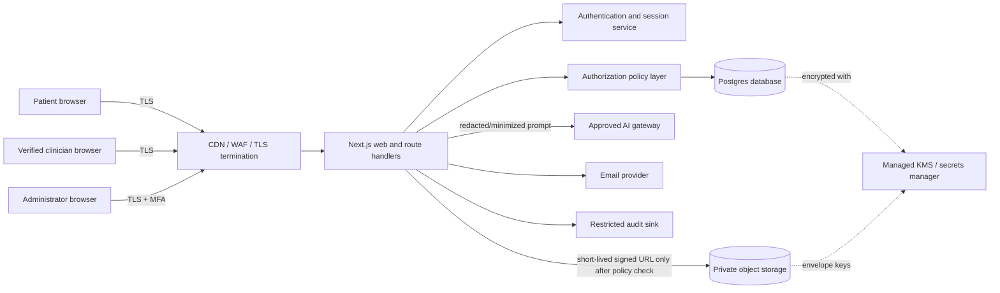

# LifeHealth ID Security Architecture

> Status: design baseline, not a compliance certification or security claim. This document identifies controls and unresolved risks before production implementation.

## 1. Scope and security objectives

LifeHealth ID stores patient-owned medical records, clinician verification data, consent grants, summaries, notifications, and audit events. The primary objectives are confidentiality of protected health information, patient-controlled sharing, strong tenant isolation, integrity of records and consent, availability with safe recovery, and accountable administration.

Synthetic data only is permitted in development, tests, and demonstrations. Production data must never be copied into local fixtures, screenshots, analytics, URLs, or logs.

## 2. Assets

| Asset | Sensitivity | Required protection |
| --- | --- | --- |
| Medical documents and metadata | Critical | Private object storage, envelope encryption, authorization on every access |
| Patient identity and contact data | High | Server-side access control, minimization, encrypted transport/storage |
| Consent grants and revocations | Critical | Append-only audit trail, transactional updates, fail-closed reads |
| AI summaries and prompts | Critical | Purpose limitation, redaction, provider policy review, no training by default |
| Doctor verification and organization membership | High | Admin-reviewed workflow, least privilege, scoped access |
| Sessions, refresh tokens, recovery secrets | Critical | HttpOnly/Secure/SameSite cookies, rotation, hashing, revocation |
| Audit events and security alerts | High | Tamper resistance, restricted access, retention policy |
| Encryption keys and application secrets | Critical | Managed secret/KMS service, rotation, never in source or logs |
| Backups and exports | Critical | Encrypted, access-controlled, tested restore, retention/deletion policy |

## 3. Trust boundaries and components



Boundaries: untrusted browser to edge; edge to application runtime; application to database; application to private storage; application to AI/email vendors; and administrator plane to production data. No browser receives database credentials, object-store credentials, master keys, or unrestricted provider tokens.

## 4. Data-flow diagram

```mermaid
sequenceDiagram
  participant P as Patient
  participant A as App/API
  participant D as Policy + DB
  participant S as Private storage
  participant I as AI gateway
  participant C as Clinician

  P->>A: authenticate with secure session
  A->>D: resolve subject and server-side policy
  P->>A: upload document metadata + bytes
  A->>D: create pending record scoped to patient
  A->>S: encrypt and store private object
  A->>D: commit object reference and hash
  P->>A: request consent grant
  A->>D: transactionally create scoped, expiring grant + audit event
  C->>A: authenticate and request patient record
  A->>D: verify clinician, org membership, active consent, purpose, expiry
  A->>S: fetch object only after allow decision
  S-->>A: object bytes
  A-->>C: stream authorized content; never expose bucket
  P->>A: request plain-language summary
  A->>D: verify ownership and allowed purpose
  A->>I: send minimized/redacted content under approved provider policy
  I-->>A: summary + provenance
  A->>D: store summary scoped to patient and source record
```

## 5. Threat model and mitigations

| Threat / abuse case | Impact | Mitigations | Residual risk |
| --- | --- | --- | --- |
| Stolen password or session cookie | Patient record disclosure | Email/password hashing, MFA for clinicians/admins, secure rotated sessions, revocation, rate limits, anomaly detection | Account recovery remains a high-value target |
| IDOR by changing patient/document ID | Cross-patient disclosure | Derive subject from session, policy query includes subject and organization scope, deny-by-default service functions, authorization tests | Logic regression requires continuous testing |
| Doctor accesses a patient without consent | Unauthorized disclosure | Active consent required for each protected request; purpose, scope, expiry, revocation, clinician verification, audit event; fail closed | Emergency access policy must be explicitly decided |
| Cross-organization clinician access | Tenant boundary breach | Membership table and organization-scoped queries; no client-supplied organization authority; transaction checks | Complex affiliations need careful lifecycle handling |
| Privilege escalation to admin | Full-system compromise | Separate roles, server-only role checks, no self-service role mutation, step-up MFA, audited admin actions | Insider threat and compromised admin account |
| Malicious upload / parser exploit | Runtime compromise or stored malware | Type/size limits, content sniffing, malware scanning, quarantine, immutable original, safe download headers, no server-side execution | Scanner false negatives/positives |
| Public storage misconfiguration | Bulk PHI exposure | Private bucket, no public ACLs, short-lived signed URLs generated only after policy check, bucket policy tests | Provider control-plane error |
| AI prompt/data leakage | PHI disclosure or unsafe advice | Explicit opt-in/use purpose, minimization/redaction, approved gateway, no training retention, provider DPA review, summaries labeled non-diagnostic, never send without authorization | Model/provider behavior and inference risk |
| XSS/CSRF/clickjacking | Session abuse or unauthorized actions | React output encoding, CSP/report-only then enforced, CSRF/origin checks for mutations, SameSite cookies, frame restrictions | Third-party script supply chain |
| SQL injection / unsafe filters | Data disclosure or corruption | Parameterized Drizzle queries, schema validation, allowlisted sort/filter fields, least-privilege DB role | ORM/query review still required |
| Notification/email account takeover | Metadata disclosure | Avoid PHI in subject/body, signed expiring links, verified destination, unsubscribe and bounce handling, rate limits | Recipient mailbox compromise |
| Audit log tampering or sensitive logging | Forensics loss / secondary disclosure | Append-only restricted sink, structured event IDs, redaction middleware, no tokens/content, alert on gaps | Log provider compromise |
| Ransomware/data deletion | Availability and integrity loss | Versioned encrypted backups, immutable retention window, restore drills, soft-delete plus legal hold, separate backup credentials | Recovery point/time objectives need approval |
| Global data residency violation | Legal/regulatory exposure | Region inventory, provider contracts, configurable residency strategy, transfer assessment | Requirements differ by user location |
| Abuse via bulk export or scraping | Mass disclosure | Export approval/step-up auth, scoped manifests, rate limits, watermarking, audit and alerts | Authorized user can still misuse data |

## 6. Database access-control plan

- Use Postgres with separate runtime roles: migration owner, application read/write role, background worker role, and read-only audit/reporting role. The web role cannot alter schemas, grant privileges, or read unrelated operational tables.
- Core tables: `users`, `sessions`, `organizations`, `organization_memberships`, `doctor_verifications`, `patients`, `medical_records`, `record_objects`, `consents`, `ai_summaries`, `notifications`, and `audit_events`.
- Every patient-owned row carries `patient_id`; every organization-owned row carries `organization_id`. Protected queries require the authenticated subject and, for clinicians, an active consent predicate in the same transaction.
- Never authorize from a client-provided role, patient ID, organization ID, or object key. Resolve identity from the server session and validate all input with a schema validator.
- Consent revocation, access checks, and audit creation are transactional. Revocation wins over cached decisions. Cache keys must include subject, patient, organization, record scope, and policy version.
- Prefer database constraints, foreign keys, unique constraints, enum-like role values, and soft-delete markers with explicit retention jobs. Add row-level security only if the selected deployment and connection mode support it reliably; application authorization remains mandatory.
- Object keys are opaque random identifiers, not patient IDs or filenames. The database stores metadata and hash; the object store remains private.

## 7. Secure implementation increments

1. Establish the data model, threat-model review, secret configuration, security headers, server-only session boundary, and synthetic fixtures.
2. Add authentication with email/password, secure cookies, session rotation/revocation, rate limiting, and server-side role checks.
3. Add private upload quarantine, malware/type/size validation, encrypted storage, and object authorization.
4. Add verified clinician and organization workflows plus consent grants, expiry, revocation, purpose, and audit events.
5. Add AI summaries only after provider retention/training, residency, and redaction decisions are approved.
6. Add backups, deletion/export workflows, incident response hooks, monitoring, and operational runbooks.

## 8. Security testing plan

- **Unit/property tests:** policy predicates, consent expiry/revocation, role matrix, input schemas, object-key generation, redaction, quantity/size limits.
- **Integration tests:** every API route with patient/doctor/org/admin/anonymous fixtures; IDOR mutations; cross-organization reads; revoked consent; replayed sessions; signed URL expiry.
- **Negative tests:** malformed uploads, polyglot files, path traversal names, oversized payloads, SQL-like filters, HTML/script payloads, CSRF/origin failures, rate-limit exhaustion.
- **Dependency and supply chain:** lockfile audit, secret scanning, SAST, dependency update review, container/runtime baseline, third-party script inventory.
- **DAST and manual review:** authenticated proxy tests, browser security headers/CSP reports, cookie flags, error redaction, export controls, admin step-up auth.
- **Resilience:** backup restore drill, key rotation rehearsal, storage outage behavior, notification provider outage, AI provider timeout/failure, audit sink backpressure.
- **Release gates:** no critical/high unresolved findings, all authorization matrix tests green, synthetic-only test data confirmed, restore evidence recorded, and security owner approval for production.

## 9. Remaining design decisions and external dependencies

1. Choose the legal/compliance operating model and jurisdictions; determine whether HIPAA, GDPR/UK GDPR, or other obligations apply. Generated code is not a certification.
2. Confirm Neon/Postgres region, private object storage provider and region, KMS/key ownership, backup retention, RPO/RTO, and deletion/legal-hold rules.
3. Confirm authentication recovery, MFA requirements by role, support impersonation policy, and emergency/break-glass access with mandatory reason and review.
4. Select email provider and notification content policy; no medical details in email by default.
5. Approve AI provider, model, retention/training settings, data processing terms, residency, redaction method, and human review policy.
6. Define clinician verification source, organization lifecycle, delegated administrators, and role approval process.
7. Define consent vocabulary, minimum necessary scopes, proxy/guardian access, minors, incapacitated patients, and revocation semantics.
8. Define retention, export, correction, deletion, audit retention, incident notification, and user support procedures.
9. Complete independent penetration testing, privacy review, threat-model review, and legal review before real medical data is accepted.

## 10. Current limitations

The existing LifeHealth ID interface is a demonstration surface with synthetic content and a demo dashboard. It is not connected to a production database, authentication system, private storage, clinician verification, consent service, or AI processing pipeline. Those integrations must be provisioned and implemented behind server-side controls before the product can accept real health information.

## 11. External dependencies to provision

- Neon Postgres (database and, if selected, Better Auth persistence)
- Private object storage with managed encryption and malware scanning
- Managed secrets/KMS
- Transactional email provider
- Approved AI gateway/provider with healthcare data processing terms
- WAF/rate limiting, monitoring, audit sink, backup/restore service
- Identity/clinician verification provider, if external verification is required

This architecture is a starting point for review, not a statement that the system is secure or compliant.

## 12. Formal review checklist

- [ ] Security architect review
- [ ] Privacy/legal review
- [ ] Database and storage region decision
- [ ] AI provider and data-processing approval
- [ ] Authentication and break-glass approval
- [ ] Backup restore evidence
- [ ] Authorization matrix test evidence
- [ ] Independent penetration test
- [ ] Production go/no-go approval

This document must be revised as implementation decisions are made.
